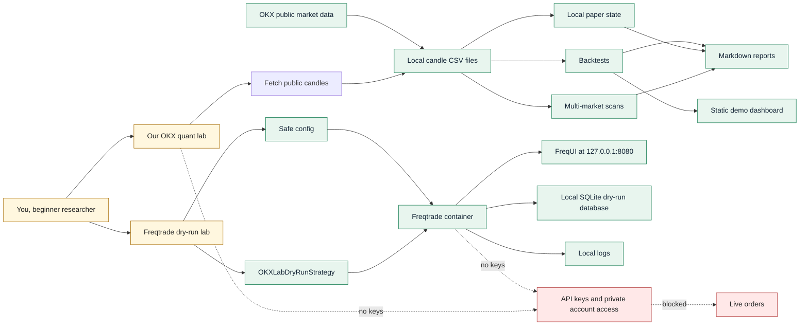
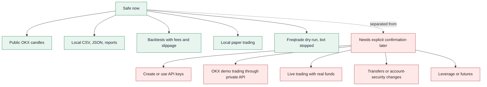
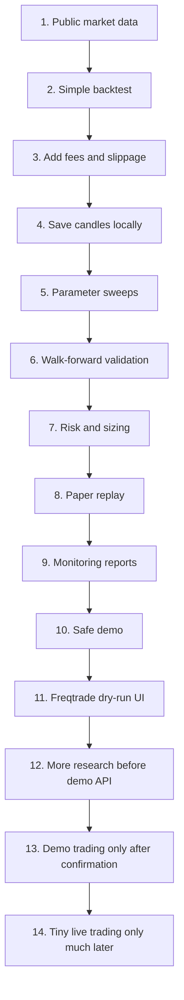
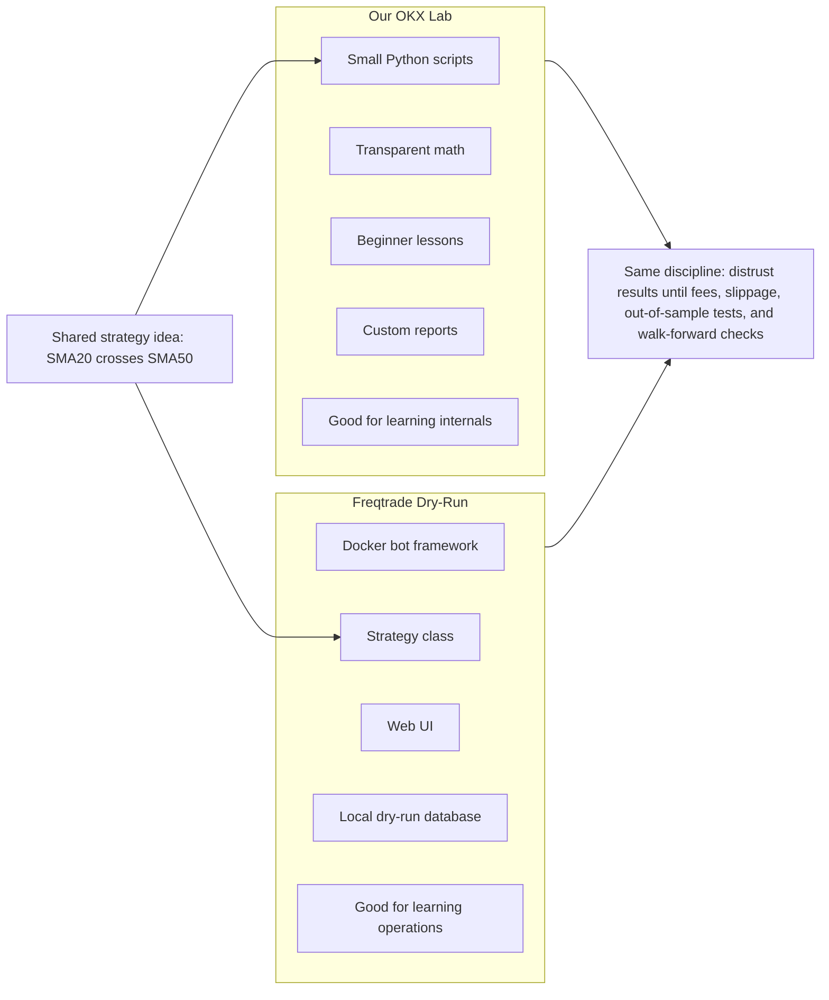
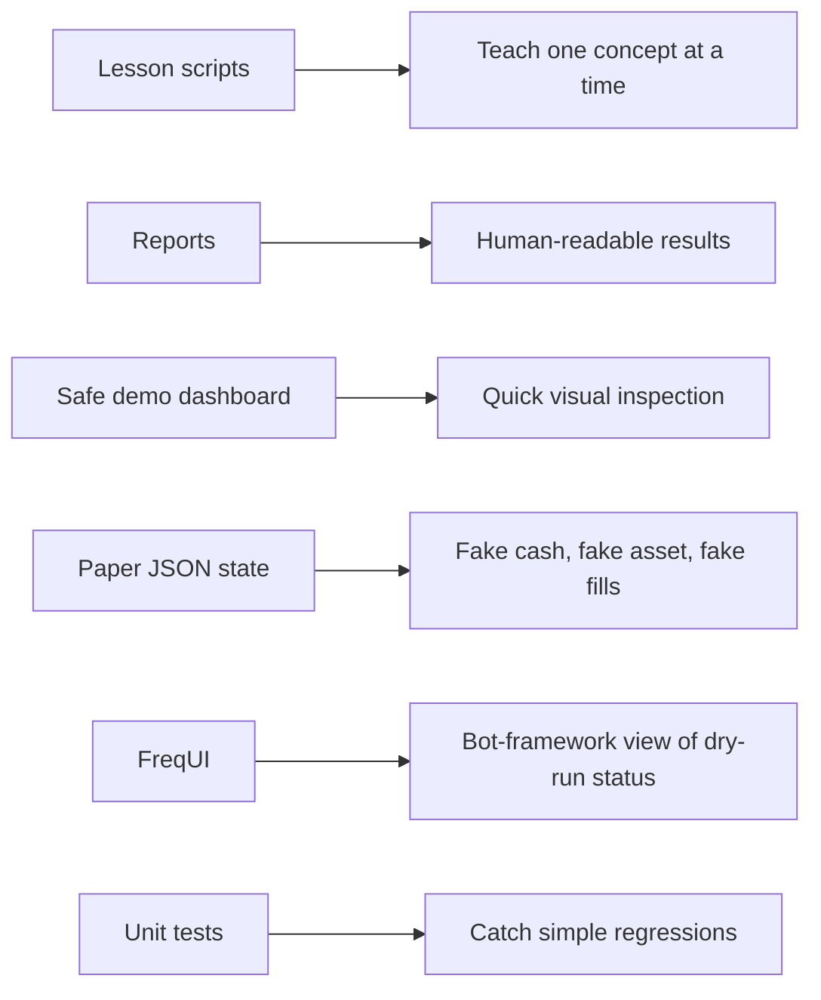

# OKX Quant Lab Visual Summary

This is the one-page map of what we have built so far.

Read it from left to right: data comes in, research code tests ideas, reports explain results, and Freqtrade gives us a safe bot-framework sandbox.

## System Map



## Safety Boundary



## Learning Ladder



## Our Lab Compared With Freqtrade



## Current Safe Runtime

| Area | Current status |
| --- | --- |
| OKX lab | Public data and local simulation only |
| Safe demo | Generates Markdown and HTML reports |
| Freqtrade | Installed in Docker |
| Freqtrade version | `2026.5.1` |
| Freqtrade URL | `http://127.0.0.1:8080` |
| Freqtrade mode | `dry_run: true` |
| Freqtrade bot state | `stopped` |
| OKX credentials | Empty |
| Live orders | Not enabled |

## What Each Output Means



## Beginner Rule Of Thumb

If a result looks profitable, the next move is not live trading.

The next move is:

```text
add costs -> split data -> test unseen periods -> walk-forward -> reduce size -> monitor -> paper trade longer
```

Only after that should we discuss demo API trading, and only with explicit confirmation.
